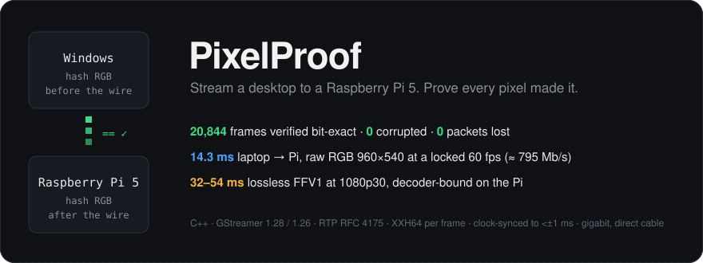
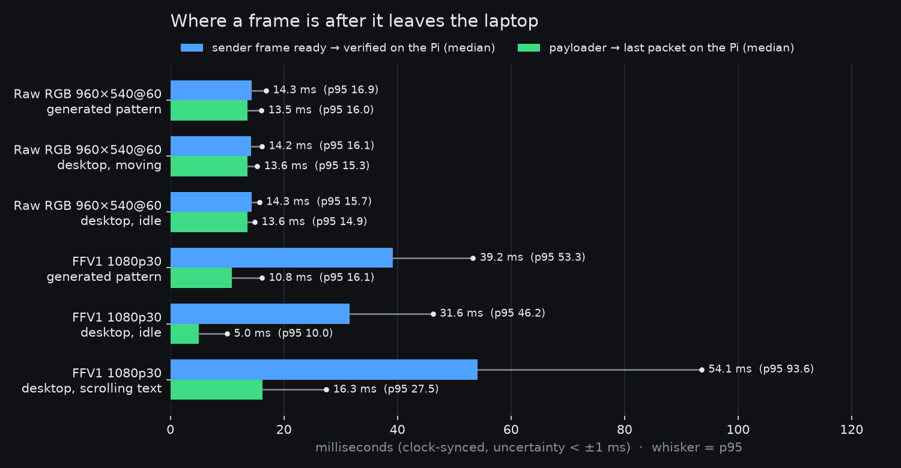
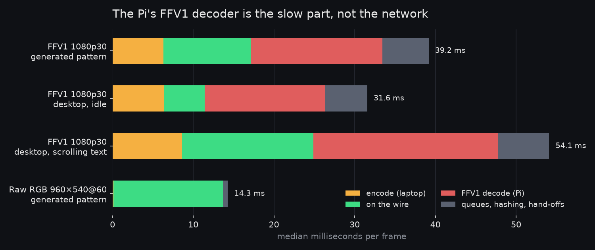
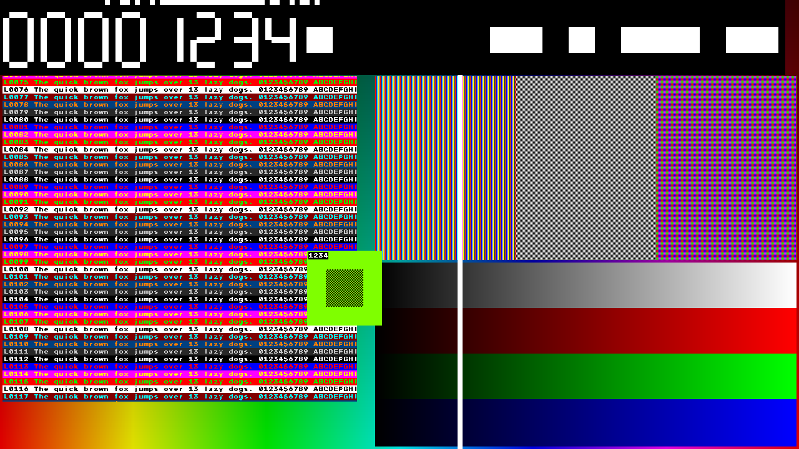
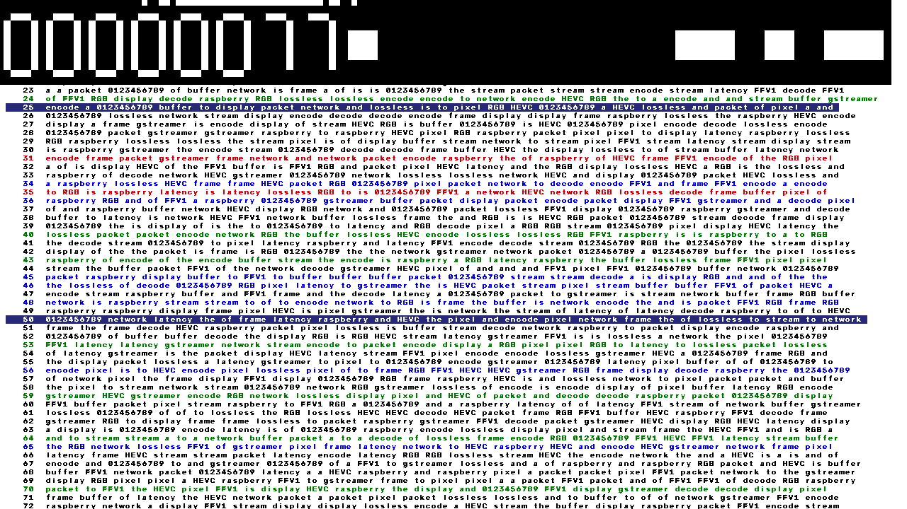

<p align="center">
  
</p>

<h1 align="center">PixelProof</h1>

<p align="center">
  <em>It doesn't say the stream looks fine. It hashes every frame on both ends and tells you.</em>
</p>

<p align="center">
  
  
  
  
  
  
</p>

<p align="center">
  <strong>Raw RGB 960×540 at a locked 60 fps: 14.3 ms from the laptop to a verified frame on the Pi.</strong><br>
  <strong>Lossless 1080p30: 32–54 ms. Zero corrupted frames. Zero lost packets.</strong><br>
  <sub>Measured over a direct gigabit cable, 3 × 30 s per mode, clock-synced to better than ±1 ms. <a href="RESULTS.md">Every number</a>.</sub>
</p>

---

Every remote-desktop tool tells you the picture *looks* right. None of them tells you whether the
pixel at row 412, column 77 is the one you sent.

PixelProof is a small C++ sender and receiver built on GStreamer's C API. The sender stamps a frame
ID into every frame and hashes the exact RGB bytes right before they hit the wire. The Raspberry Pi
rebuilds the frame, hashes it again, and sorts it into one of five buckets: **ok, corrupted,
incomplete, never arrived, dropped by the receiver**. Latency comes with its error bar, because the
two clocks are synchronised and the uncertainty is carried with every frame.

## Numbers

<p align="center">
  
</p>

| Mode | Frames bit-exact | Fps | On the wire | Frame ready → verified on Pi |
|---|---|---|---|---|
| Raw RGB 960×540@60, generated pattern | **5406 / 5406** | 60.0 | 795 Mb/s | 14.3 ms (p95 16.9) |
| Raw RGB 960×540@60, live desktop | **7451 / 7451** | 23–53 ¹ | 300–700 Mb/s | 14.2 ms (p95 16.1) |
| FFV1 1080p30, generated pattern | **2702 / 2702** | 30.0 | 222 Mb/s | 39.2 ms (p95 53.3) |
| FFV1 1080p30, live desktop (idle / scrolling text) | **5285 / 5285** | 28–30 | 85–288 Mb/s | 31.6 / 54.1 ms |

<sub>¹ Windows Desktop Duplication only hands over a frame when the screen changes. Every frame it produced arrived intact.</sub>

**The interesting part is where the time goes.** Raw RGB spends 13.5 of its 14.3 ms on the wire:
one 1.55 MB frame takes about 13 ms to cross gigabit Ethernet, so the link *is* the latency. FFV1
fixes the bandwidth (6–15× smaller) and moves the problem to the Pi's CPU:

<p align="center">
  
</p>

## What the Pi sees

<p align="center">
  
  
</p>

The test pattern is built to embarrass lossy codecs: 1-pixel text in red-on-blue and
yellow-on-magenta (the colour pairs 4:2:0 subsampling smears first), 1-pixel stripes and a
checkerboard, a chroma zone, ramps, a bouncing box, and a frame counter big enough for a phone
camera to read. It is deterministic: frame *N* has the same bytes on Windows and on the Pi.

## How it works

```
 Windows                                                         Raspberry Pi 5
 ───────                                                         ──────────────
 source ─▶ convert/scale ─▶ stamp ID ─▶ bounded queue ─▶ XXH64 ─┐
 (pattern · desktop ·        to RGB      (drops, never   of the  │   RTP/UDP, gigabit
  USB capture · any gst)                  stalls)        exact   ├────────────────────▶ rebuild ─▶ XXH64 ─▶ compare
                                                         bytes   │                      (RFC 4175 or      │
                                         raw RFC 4175 or FFV1 ◀──┘                       FFV1 decode)     ▼
                                                                                                    ok · corrupted ·
 side channel: {frame id, RTP timestamp, hash, send time in the Pi's clock ± uncertainty} ─────▶    incomplete · lost
```

* **Canonical bytes.** R, G, B per pixel, rows back to back, no padding, whatever the buffer's
  real layout or stride. Both ends use the same function, so channel order and row padding can't
  fake a mismatch.
* **What "exact" proves.** The reference is the frame after scaling and conversion. An exact match
  proves the transport and codec preserved those pixels; it says nothing about the original
  2560×1600 desktop before it was scaled.
* **Five buckets.** The raw path uses its own RFC 4175 reassembler, so it knows exactly which lines
  of which frame arrived. Incomplete and corrupted are never lumped together.
* **Latency with an error bar.** The sender pings the Pi, keeps the fastest round trip per second,
  fits the clock drift, and throws away pings stuck behind video bursts. Typical uncertainty:
  ±0.4–0.8 ms.
* **Bounded everything.** Leaky queues on both ends and a small socket buffer. When the link
  can't keep up, PixelProof drops whole frames and says so; it never builds a hidden queue. (On a
  100 Mb/s link, even a 2 MiB socket buffer meant frames waited 176 ms before their first packet left.)

## Use it

Windows (Visual Studio 2022 C++ workload + GStreamer 1.28 MSVC):

```powershell
winget install gstreamerproject.gstreamer
.\scripts\build-windows.ps1
```

Raspberry Pi OS (trixie):

```bash
./scripts/build-pi.sh && ./build/pi/sb_selftest
```

Direct cable, temporary addresses (nothing persistent; Wi-Fi and SSH untouched):

```powershell
.\scripts\link-setup.ps1 -Adapter "Ethernet 2"          # laptop: 10.77.0.1/24
ssh pi 'sudo ~/stream-bench/scripts/link-setup-pi.sh'   # Pi: 10.77.0.2/24
py -3 scripts\link-check.py --tx-ip 10.77.0.1 --rx-ip 10.77.0.2
```

One stream by hand:

```bash
# Pi
./build/pi/sb_receiver --mode raw --width 960 --height 540 --fps 60 --bind 10.77.0.2 --display wayland
# Windows
sb_sender --source pattern --codec raw --width 960 --height 540 --fps 60 --dest 10.77.0.2 --bind 10.77.0.1
```

The whole matrix, 3 samples per mode, with Pi temperature, throttling, power and NIC/UDP drop
counters recorded before and after every sample:

```powershell
py -3 scripts\passes.py --tx-ip 10.77.0.1 --rx-ip 10.77.0.2 --pass A   # raw RGB
py -3 scripts\passes.py --tx-ip 10.77.0.1 --rx-ip 10.77.0.2 --pass B   # FFV1 1080p30 + p60
```

Everything lands in `results/<run>/sample_n/`, with one row per sample in `results/summary.csv`.
`py -3 tools/make_figures.py` redraws the charts above from it.

### Inputs

| `--source` | what |
|---|---|
| `pattern --scene test\|text\|static` | the generator above, a scrolling document page, or a frozen frame |
| `desktop --monitor DISPLAY1` | Windows Desktop Duplication, scaled on the GPU |
| `capture --device N` | a USB/UVC capture card (`mfvideosrc` on Windows, `v4l2src` on Linux) |
| `"gst:<fragment>"` | any GStreamer pipeline that produces raw video |

New inputs live in `src/sender/sources.cpp`; the rest of the pipeline does not change.

### Glass-to-glass with a phone

Show the stamped pattern on the laptop panel (`sb_sender ... --preview-monitor 0`) and on the TV at
the same time, then film both at 240 fps for 30 s. `tools/camera_latency.py` reads the Gray-code
blocks on both screens in every video frame and turns the ID difference into milliseconds. A Gray
code changes only one bit per frame, so a camera frame caught mid-refresh reads the old ID or the
new one, never garbage.

### 4K60 comparison

`sb_vdisplay` creates a temporary 3840×2160 @ 60 virtual monitor through the Parsec Virtual Display
driver, so Sunshine can capture a real 4K60 desktop on a laptop that doesn't have one. Moonlight
6.2.0 on the Pi does the receiving (`moonlight-qt stream <host> Desktop --4K --fps 60 --video-codec HEVC --video-decoder hardware`).

## Status

* ✅ Pass A, raw RGB 960×540@60: done ([RESULTS.md](RESULTS.md))
* ✅ Pass B, FFV1 1080p30: pattern, idle desktop and scrolling text done
* ⏸ FFV1 1080p60 and the high-motion desktop: on hold, see *Known issues*
* ⏳ HDMI output check, glass-to-glass camera run, Sunshine → Moonlight HEVC 4K60: need a TV on the Pi
* ✖ PyroWave: Valve says the Pi's GPU can't decode it. It needs a PC, Mac or Steam Link on Apple/Android

## Known issues

* **Heavy mode crashed the test laptop once.** A full-screen 2560×1600 preview, Desktop Duplication
  of the same panel and 16-slice FFV1 encoding, all at once, hard-reset an RTX 5080 laptop with no
  bug check. `passes.py` skips that mode unless you pass `--allow-heavy`.
* Windows Desktop Duplication delivers fewer than 60 frames per second when the screen changes
  slowly. That is a capture-side limit, and it is reported separately from transport drops.

## Layout

```
src/common     XXH64, frame stamp, pattern generator, canonical hashing, sockets/CSV/CPU helpers
src/sender     sb_sender, its inputs, full-screen preview windows
src/receiver   sb_receiver (RFC 4175 reassembler, FFV1 path, display)
tools          self-test, Parsec virtual display, camera analysis, figures, result sanitiser
scripts        builds, link setup/check, benchmark runner, pass matrix
results        raw measurements from the runs in RESULTS.md
```

## License

MIT
